::: {.content-visible when-format="html"}
::: {.format-links}
[Other formats:]{.label}
```{=html}
<a href="notes.pdf" title="Week 10 lecture notes as a PDF"
   data-goatcounter-click="pdf-week10"
   data-goatcounter-title="Week 10 notes PDF opened">&#128196;&nbsp;PDF</a>
```
:::
:::

::: {.content-visible when-format="pdf"}
The figures below are snapshots of interactive widgets. The live versions, where
you can move the sliders yourself, are at
[tchaffey.com/elec2302](https://tchaffey.com/elec2302/?ref=notes-pdf-week10).
:::

## Lecture outline

<!-- CHECK: page 1 numbers two items "5." (Audio example, and Cascaded filters). Renumbered
1–8. "(update week 1 widget)" after "Audio example" is an instruction and is not typeset;
the updated widget is in the first and second order filters section. ": low pass to other
types" is typeset as a sub-item of Cascaded filters. -->

1. Intro, motivation
2. Ideal filters: lowpass, high pass, band pass, band stop, all pass.
3. Realisable filter specifications
4. 1^st^ &amp; 2^nd^ order filters
5. Audio example.
6. Cascaded filters: Phono preamp. (Design example 1).
    * low pass to other types.
7. Higher order filters: Butterworth. 2^nd^ order: $\zeta = \dfrac{1}{\sqrt{2}}$
8. Design example 2.

```{=html}
<hr style="border:0;border-top:1.5px solid #00468C;margin:1.6em 0;">
```

"Filtering" a signal means removing unwanted parts of its frequency spectrum. For example:

* Ferrite beads on cables remove radio frequency interference
* Ripple filters on power supplies smooth converted AC signals
* Suspension filters out road noise/bumps.
* Rumble filters reject slow oscillations caused by warped vinyl records.
* Earthquake vibration suppression that we saw last week
* Anti-aliasing filters before converting analogue to digital.
* And <u>many</u> more. Any piece of electronics is full of filters.

This lecture will give an introduction to how we design filters from given specifications.
This is a broad topic, there is much more to learn!

## Ideal filters

An ideal filter has two characteristics:

1. Perfect transmission (no distortion) of the signals we want (the "passband").
2. Perfect rejection of the signals we don't want (the "stopband").

There are four ideal filter types:

:::: {.columns}
::: {.column width="45%"}
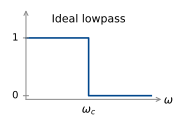{fig-alt="Ideal lowpass: gain 1 below omega_c, 0 above."}
:::
::: {.column width="10%"}
:::
::: {.column width="45%"}
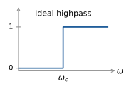{fig-alt="Ideal highpass: gain 0 below omega_c, 1 above."}
:::
::::

:::: {.columns}
::: {.column width="45%"}
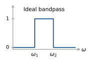{fig-alt="Ideal bandpass: gain 1 between omega_1 and omega_2, 0 elsewhere."}
:::
::: {.column width="10%"}
:::
::: {.column width="45%"}
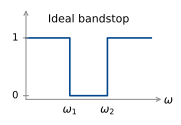{fig-alt="Ideal bandstop: gain 0 between omega_1 and omega_2, 1 elsewhere."}
:::
::::

:::: {.columns}
::: {.column width="55%"}
:::
::: {.column width="45%"}
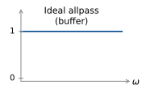{fig-alt="Ideal allpass (buffer): gain 1 at all frequencies."}
:::
::::

Can we build an ideal filter?

Let's look more closely at the ideal lowpass filter. If we consider negative frequencies as
well, we have

:::: {.columns}
::: {.column width="50%"}
$$
\begin{aligned}
G(j\omega) &= \begin{cases} 1, & \lvert\omega\rvert < \omega_c \\ 0, & \lvert\omega\rvert > \omega_c. \end{cases} \\[10pt]
           &= p_{2\omega_c}(\omega)
\end{aligned}
$$
:::
::: {.column width="50%"}
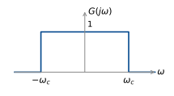{fig-alt="G(j omega) equal to 1 between minus omega_c and omega_c, 0 outside."}
:::
::::

We can find the impulse response of this filter by finding the inverse Fourier transform in
our table of transforms:

:::: {.columns}
::: {.column width="55%"}
$$
\begin{aligned}
g(t) &= \frac{\sin(\omega_c t)}{\pi t} \\[10pt]
     &= \frac{\omega_c}{\pi}\,\frac{\sin(\pi T)}{\pi T} \qquad \text{where } T = \frac{\omega_c t}{\pi}. \\[10pt]
     &= \frac{\omega_c}{\pi}\operatorname{sinc}(T) = \frac{\omega_c}{\pi}\operatorname{sinc}\!\left(\frac{\omega_c t}{\pi}\right).
\end{aligned}
$$
:::
::: {.column width="45%"}
$$
\begin{aligned}
\pi T &= \omega_c t \\[4pt]
T &= \frac{\omega_c t}{\pi}, \qquad t = \frac{\pi T}{\omega_c}
\end{aligned}
$$

$$ \text{So } \frac{1}{\pi t} = \frac{\omega_c}{\pi^2 T} = \frac{\omega_c}{\pi}\,\frac{1}{\pi T} $$
:::
::::

<!-- CHECK: the axis of the sketch on p4 is labelled h(t), while the equations above use
g(t). Labelled g(t). Tick labels at multiples of π/ω_c and the peak value ω_c/π are added;
the handwritten sketch has none. -->

::: {style="text-align:center"}
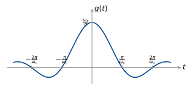{width=540 fig-alt="The impulse response g(t), a sinc centred on t = 0 with peak omega_c over pi, nonzero for negative and positive time."}
:::

The impulse response goes backwards in time as well as forwards! No surprise, this can't be
built (unless you record the whole signal first then filter it).

<!-- CHECK: section heading below is not in the handwriting. It is item 3 of the outline on
page 1, added so the table of contents has an entry for pages 5–6. Delete it if unwanted. -->

## Realisable filter specifications

So in practice, we need to compromise on the ideal filter characteristics of perfect
transmission of the passband and perfect rejection of the stopband. A real low pass filter
has an amplitude response in an allowable region:

::: {style="text-align:center"}
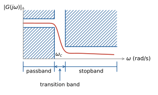{width=540 fig-alt="Allowable region for a lowpass gain: hatched forbidden regions above and below the passband up to omega_c, and above the stopband level beyond the transition band. The passband, transition band and stopband are marked on the frequency axis."}
:::

The width of the passband is also known as the bandwidth for a low pass filter. Its precise
definition depends on the specification, but commonly it is the frequency where the gain
first drops below $-3$ dB.

We have already seen many low pass filters in this course:

:::: {.columns}
::: {.column width="45%"}
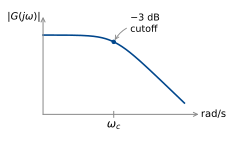{fig-alt="Gain of a first order lowpass: flat, then falling, with the minus 3 dB cutoff at omega_c."}
:::
::: {.column width="55%"}
$$ \frac{1}{j\omega + \omega_c} $$
:::
::::

:::: {.columns}
::: {.column width="45%"}
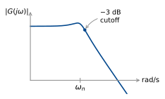{fig-alt="Gain of a second order lowpass: flat, a small peak near omega_n, the minus 3 dB cutoff just above it, then falling."}
:::
::: {.column width="55%"}
$$ \frac{\omega_n^2}{(j\omega)^2 + 2\omega_n\zeta j\omega + \omega_n^2} $$

<!-- CHECK: the circuit on p6 labels the input v_in and the output v_out. Labelled u(t) and
y(t) under the course notation. No component values are given. -->

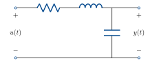{width=300 fig-alt="Series RLC circuit with input u(t) and output y(t) across the capacitor."}
:::
::::

<!-- NEW WIDGET: w-lp2 in filter-widgets.js. The week 1 resonant low-pass widget
(lecture 1/resonant-lowpass.html) ported into the notes, with the Q slider replaced by a
damping ratio slider (ζ from 0.025 to 2.5, log scale, start 1/√2) and f_0 renamed f_n. -->

::: {.content-visible when-format="html"}
```{=html}
<div id="w-lp2" class="widget"></div>
```
:::

::: {.content-visible when-format="pdf"}
{#fig-lp2 width=100%}
:::

We've also seen high pass filters (although they have infinite gain at high frequency, which of course can't actually be built).

<!-- CHECK: jω + ω_c and ((jω)^2 + 2ω_nζjω + ω_n^2)/ω_n^2 are typeset as written. Neither
is proper: their gains rise without bound, as the sketches show. They are the reciprocals of
the two lowpass filters above. -->

:::: {.columns}
::: {.column width="45%"}
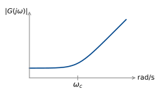{fig-alt="Gain of j omega plus omega_c: flat, then rising after omega_c."}
:::
::: {.column width="55%"}
$$ j\omega + \omega_c $$
:::
::::

:::: {.columns}
::: {.column width="45%"}
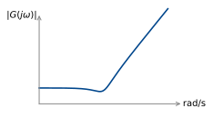{fig-alt="Gain of a complex zero pair: flat, a dip, then rising."}
:::
::: {.column width="55%"}
$$ \frac{(j\omega)^2 + 2\omega_n\zeta j\omega + \omega_n^2}{\omega_n^2} $$
:::
::::

## Design example 1: RIAA phono equalisation

A turntable converts a mechanical signal cut into a vinyl record into an electrical signal
using a stylus and cartridge:

::: {style="text-align:center"}
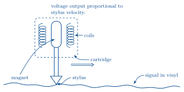{width=560 fig-alt="Moving magnet cartridge: a magnet on the stylus cantilever sits between two coils inside the cartridge. The stylus tip follows the groove, the signal in the vinyl, as the record moves."}
:::

(A moving magnet style cartridge).

Low frequencies move slower, so large grooves must be cut to achieve the same stylus
velocity. This reduces the length of signal that can be represented on the vinyl. For this
reason, it is standard to filter the signal before cutting the vinyl, to reduce the
amplitude at low frequencies. At playback, this filtering is reversed, by a
<u>phono stage</u>. The most common specification is RIAA (Recording Industry Association of
America). This specification also boosts high frequencies at recording, which are then
attenuated at playback. This means surface noise (pops, clicks) are also attenuated.

<!-- CHECK: p8 pastes the Wikipedia RIAA equalisation plot and annotates it by hand. The
figure here is redrawn from the transfer function below (k = 13197), with the pole, zero and
−20 dB/dec annotations placed at the exact break frequencies. If you want the Wikipedia
image itself, it is the first embedded image on p8 of the source PDF. -->

::: {style="text-align:center"}
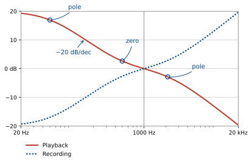{width=620 fig-alt="RIAA playback curve falling from about +19 dB at 20 Hz to about −20 dB at 20 kHz through 0 dB at 1 kHz, with the recording curve its mirror image. Poles marked at 50 Hz and 2122 Hz and a zero at 500 Hz on the playback curve, with a −20 dB per decade slope marked."}
:::

The curve is specified by three first order break frequencies:

$$
\begin{aligned}
f_1 &= 50.05\ \text{Hz} &&= 314.5\ \text{rad/s} &&(\text{pole}) \\[4pt]
f_2 &= 500.5\ \text{Hz} &&= 3145\ \text{rad/s}  &&(\text{zero}) \\[4pt]
f_3 &= 2122\ \text{Hz}  &&= 13333\ \text{rad/s} &&(\text{pole}).
\end{aligned}
$$

It is customary to normalise by setting the gain to 0 dB at
$1\ \text{kHz} = 6283\ \text{rad/s}$.

What is the transfer function of this filter?

We can read the poles and zeros directly from the specification:

$$ G(j\omega) = \frac{(j\omega + 3145)\,k}{(j\omega + 314.5)(j\omega + 13333)} $$

To find the gain $k$, we substitute $\omega = 6283$ and find $\lvert G(j\omega)\rvert$.
First, find the gain of each component:

$$ \lvert(j\omega + p)\rvert = \sqrt{\omega^2 + p^2} $$

<!-- CHECK: p9 gives 14740.0 for the pole at 13333. sqrt(6283^2 + 13333^2) = 14739.2.
Typeset 14739.2. -->

$$
\left\{
\begin{aligned}
&\text{pole at } 314.5\text{:} &\quad 6291.0 &= p_1 \\[4pt]
&\text{pole at } 13333\text{:} &\quad 14739.2 &= p_2 \\[4pt]
&\text{zero at } 3145\text{:}  &\quad 7026.2 &= z_1.
\end{aligned}
\right.
$$

<!-- CHECK: p9 writes "0.(7.57?×10^-5) k = 1"; the leading "0." looks like a false start
and the fourth digit is unclear. 7026.2/(6291.0 × 14739.2) = 7.578×10^-5. Typeset as below.
k = 13197 is unchanged. -->

$$ \text{Total gain} = \frac{k z_1}{p_1 p_2} = \left(7.578\times 10^{-5}\right) k = 1 $$

So $k = 13197$.

<!-- CHECK: section heading below is not in the handwriting. It is the sub-item of item 6 of
the outline on page 1, added so the table of contents has an entry for pages 9–11. Delete
it if unwanted. -->

## Low pass to other types

This is a lowpass filter. How do we get the highpass filter that is used before cutting the
vinyl? Invert the filter:

<!-- CHECK: p_1, p_2 and z_1 were defined above as the gains |jω + p| at ω = 6283, but here
they stand for the pole and zero locations 314.5, 13333 and 3145. The left side is written
G(s) and the right side in jω. Typeset as written. -->

$$ \frac{1}{G(s)} = \frac{(j\omega + p_2)(j\omega + p_1)}{(j\omega + z_1)\,k} $$

In general, this method of inverting to get a highpass from a lowpass is dangerous – if the
lowpass has a right half plane zero, the inverse will be unstable. A better transform is
mapping $s$ to $\dfrac{1}{s}$:

<!-- CHECK: p10 gives the right-hand side as k(1 + sz_1)/((1 + sp_1)(1 + sp_2)). Multiplying
through by s^2 leaves a factor of s in the numerator, k s(1 + sz_1)/((1 + sp_1)(1 + sp_2)).
Typeset with the s. The extra s is a zero at s = 0 (the lowpass had one more pole than
zeros), which the next line does not mention. -->

$$
\frac{k(s + z_1)}{(s + p_1)(s + p_2)} \;\mapsto\;
\frac{k\left(\frac{1}{s} + z_1\right)}{\left(\frac{1}{s} + p_1\right)\left(\frac{1}{s} + p_2\right)}
= \frac{k\,s\,(1 + sz_1)}{(1 + sp_1)(1 + sp_2)}.
$$

Poles and zeros map to $\dfrac{1}{p}$, $\dfrac{1}{z}$.

So, if we want a highpass filter with a particular corner frequency, we can design a lowpass
filter with corner frequency $\dfrac{1}{\omega_c}$ and then map $s \mapsto \dfrac{1}{s}$.

The transform $s \mapsto \dfrac{1}{s}$ preserves stability. If $p$ is a stable pole, so is
$\dfrac{1}{p}$.

What about bandpass and bandstop filters, how can we build these? We can use a combination
of high pass and low pass:

<!-- CHECK: the p10 sketch joins the highpass and lowpass shapes with "+". The text beside it
says cascade, where the gains multiply, so the figure uses ×. -->

:::: {.columns}
::: {.column width="62%"}
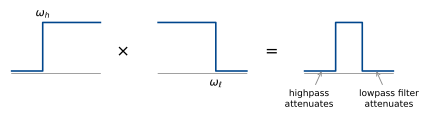{fig-alt="A highpass with cutoff omega_h times a lowpass with cutoff omega_l gives a bandpass. The highpass attenuates below the band and the lowpass filter attenuates above it."}
:::
::: {.column width="38%"}
Bandpass = cascade of lowpass and highpass, $\omega_h < \omega_\ell$
:::
::::

The only signals that pass are those that are in the passband of both filters.

To get a bandstop, we want the gain in the passband to be reasonably close to 1 (0 dB).
Instead of cascading, where gains multiply, we use a parallel interconnection:

::: {style="text-align:center"}
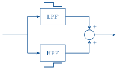{width=400 fig-alt="Parallel interconnection: the input feeds an LPF and an HPF, and their outputs are added at a summing junction."}
:::

The LPF passes low frequencies. The HPF passes high frequencies. Where their stopbands
overlap, no signal passes.

<!-- NEW WIDGET: w-lphp in filter-widgets.js. Gain plots of a second order lowpass and
highpass (ζ = 1/√2), their cascade and their sum, with sliders for ω_ℓ and ω_h and a sweep
of ω_h. Starts at ω_h = 1 rad/s, ω_ℓ = 10 rad/s. -->

::: {.content-visible when-format="html"}
```{=html}
<div id="w-lphp" class="widget"></div>
```
:::

::: {.content-visible when-format="pdf"}
{#fig-lphp width=100%}
:::

## Butterworth filters

::: {style="text-align:center"}
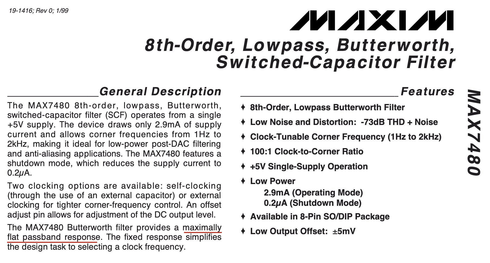{width=640 fig-alt="Header of the MAX7480 datasheet: 8th-order, lowpass, Butterworth, switched-capacitor filter, with the phrase maximally flat passband response underlined."}
:::

<!-- CHECK: the red line on p12 runs through "maximally flat passband response" in the
datasheet clip. Drawn as an underline. -->

Butterworth filters are a popular practical filter design. The response is designed to have
"maximally flat passband response",[^flat] that is, no ripples in the gain response.

[^flat]: The largest possible number of derivatives of $\lvert G(j\omega)\rvert^2$ are zero
at $\omega = 0$, without any transfer function zeros.

An $n^{\text{th}}$ order lowpass Butterworth filter with cutoff frequency $\omega_c$ is the
stable filter with:

* $n$ poles
* no zeros
* magnitude response satisfies
  $$ \lvert G(j\omega)\rvert^2 = \frac{1}{1 + \left(\dfrac{\omega}{\omega_c}\right)^{2n}}. $$

The gain is 1 at DC and $\dfrac{1}{\sqrt{2}}$ ($-3$ dB) at $\omega = \omega_c$.

::: {style="text-align:center"}
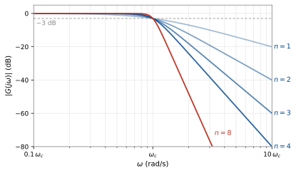{width=600 fig-alt="Butterworth gain in dB against omega for n = 1, 2, 3, 4 and 8. All pass through minus 3 dB at omega_c and fall at 20n dB per decade beyond it."}
:::

:::: {.columns}
::: {.column width="62%"}
To get the desired magnitude response, we place $n$ poles on the semicircle of radius
$\omega_c$ in the left half plane.
:::
::: {.column width="38%"}
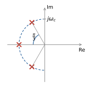{fig-alt="Three poles on the left half of the circle of radius omega_c, at angles 2 pi over 3, pi and 4 pi over 3, spaced pi over 3 apart."}
:::
::::

Let's see why this works:

$$ \lvert G(j\omega)\rvert^2 = G(j\omega)\,G(-j\omega) $$

$$ \text{so } G(s)G(-s) = \frac{1}{1 + \left(\dfrac{-s^2}{\omega_c^2}\right)^n} $$

(note if $s = j\omega$, $-s^2 = \omega^2$).

$$ = \frac{\omega_c^{2n}}{\omega_c^{2n} + (-s^2)^n}. $$

So the poles of $G(s)G(-s)$ are the roots of

$$ \omega_c^{2n} + (-s^2)^n = 0. $$

$$ 1 + \left(\frac{-s^2}{\omega_c^2}\right)^n = 0. $$

Setting $s = \omega_c e^{j\theta}$ (a point on the radius $\omega_c$ circle), we have
solutions at

$$ \theta = \frac{(2k + 1)\pi}{2n} - \frac{\pi}{2}, \qquad k = 0, 1, \ldots, 2n - 1. $$

::: {style="text-align:center"}
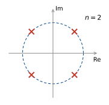{width=260 fig-alt="For n = 2, the four roots on the circle of radius omega_c at 45, 135, 225 and 315 degrees."}
:::

We then put all the left-half plane poles in $G(s)$, then $G(-s)$ has their reflections in
the right half plane, so $G(s)G(-s)$ has the right poles.

The first couple of Butterworth filters have the following transfer functions:

<!-- CHECK: the n = 2 denominator on p14 (and again on p16) reads s^3 + √2 ω_c s + ω_c^2.
Typeset s^2, which matches ζ_1 = sin(π/4) = 1/√2 and the order. -->

$$
\begin{aligned}
n = 1 &\qquad G(s) = \frac{\omega_c}{s + \omega_c} \\[12pt]
n = 2 &\qquad G(s) = \frac{\omega_c^2}{s^2 + \sqrt{2}\,\omega_c s + \omega_c^2} \\[12pt]
n = 3 &\qquad G(s) = \frac{\omega_c^3}{(s + \omega_c)(s^2 + \omega_c s + \omega_c^2)}.
\end{aligned}
$$

$$
\left.
\begin{aligned}
n \text{ even} &\qquad G(s) = \prod_{k=1}^{n/2} \frac{\omega_c^2}{s^2 + 2\zeta_k\omega_c s + \omega_c^2} \\[12pt]
n \text{ odd}  &\qquad G(s) = \frac{\omega_c}{s + \omega_c}\prod_{k=1}^{(n-1)/2} \frac{\omega_c^2}{s^2 + 2\zeta_k\omega_c s + \omega_c^2}
\end{aligned}
\;\right\}
\quad \zeta_k = \sin\!\left(\frac{(2k - 1)\pi}{2n}\right).
$$

To get highpass filters, use the trick above: replace $\dfrac{s}{\omega_c}$ with
$\dfrac{\omega_c}{s}$.

## Design example 2: heartrate measurement on a smartwatch

The heartrate monitor on a running watch or smartwatch uses photoplethysmography (PPG). An
LED shines light into the wrist and a photodiode measures the reflection, which pulses with
each heartbeat. A passband filter is used to remove both high and low frequency
interference.

<u>Passband:</u> 30–240 bpm = 0.5 Hz to 4 Hz.

<u>HF interference:</u> mains power oscillates at 50 Hz, ambient light follows the square of
the mains voltage at 100 Hz.

<u>LF interference:</u> breathing adds $\approx 0.2$ Hz oscillation.

[How common noise and error sources affect optical biosensing](https://www.analog.com/en/resources/design-notes/how-common-noise-and-error-sources-affect-optical-biosensing.html)

To deal with these constraints, we have the following filter specification:

* At most 3 dB loss at 0.5 Hz and 4 Hz.
* At least 20 dB attenuation at 0.2 Hz.
* At least 40 dB attenuation at 50 Hz.

Let's draw these on a Bode diagram

<!-- CHECK: the p16 annotation reads "slightly less than −60 dB/dec" or "−40 dB/dec"; the 4 is
written like the 4 in the −40 axis label. Typeset −40 dB/dec: the line from 0 dB at 4 Hz to
−40 dB at 50 Hz has slope −36.5 dB/dec. The axis is labelled Hz, which the handwriting
leaves unlabelled. The "5" tick next to 4 is kept as written. -->

::: {style="text-align:center"}
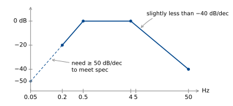{width=620 fig-alt="Specification on a Bode diagram: 0 dB from 0.5 Hz to 4 Hz, minus 20 dB at 0.2 Hz, minus 40 dB at 50 Hz. The low side needs at least 50 dB per decade, extended dashed to minus 50 dB at 0.05 Hz. The high side is slightly less than minus 40 dB per decade."}
:::

<!-- CHECK: p16 writes ω_h = 0.5 rad/s and ω_ℓ = 4 rad/s, but the specification is 0.5 Hz
and 4 Hz. Typeset as 2π × 0.5 rad/s and 2π × 4 rad/s. The orders n = 3 and n = 2 depend
only on the frequency ratios and are unchanged. -->

If we place Butterworth filters with $\omega_h = 2\pi\times 0.5$ rad/s,
$\omega_\ell = 2\pi\times 4$ rad/s, we know we meet the $-3$ dB spec (this is the gain of a
Butterworth at $\omega_c$).

We need $n = 3$ for the highpass and $n = 2$ for the lowpass.

<!-- CHECK: p16 substitutes ω_h/s for s in the n = 3 filter. Replacing s/ω_c with ω_c/s
means s ↦ ω_h^2/s, and that substitution is what gives the final line. Typeset ω_h^2/s. -->

$$
\begin{aligned}
n = 2 &\qquad G(s) = \frac{\omega_\ell^2}{s^2 + \sqrt{2}\,\omega_\ell s + \omega_\ell^2} \\[16pt]
n = 3 &\qquad G(s) = \frac{\omega_h^3}{\left(\dfrac{\omega_h^2}{s} + \omega_h\right)\left(\left(\dfrac{\omega_h^2}{s}\right)^2 + \omega_h\left(\dfrac{\omega_h^2}{s}\right) + \omega_h^2\right)} \\[16pt]
      &\qquad\phantom{G(s)} = \frac{s^3}{(\omega_h + s)(\omega_h^2 + \omega_h s + s^2)}
\end{aligned}
$$

[Analog Devices MAX30112](https://www.analog.com/en/products/max30112.html)

```{=html}
<script src="filter-widgets.js"></script>
```
