::: {.content-visible when-format="html"}
::: {.format-links}
[Other formats:]{.label}
```{=html}
<a href="notes.pdf" title="Week 11 lecture notes as a PDF"
   data-goatcounter-click="pdf-week11"
   data-goatcounter-title="Week 11 notes PDF opened">&#128196;&nbsp;PDF</a>
```
:::
:::

::: {.content-visible when-format="pdf"}
The figures below are snapshots of interactive widgets. The live versions, where
you can move the sliders yourself, are at
[tchaffey.com/elec2302](https://tchaffey.com/elec2302/?ref=notes-pdf-week11).
:::

1. Motivation: wireless communication
2. Amplitude modulation
3. Demodulation
4. Frequency division multiplexing
5. Frequency modulation
6. Phase modulation.

::: {.note}
Based on the lectures of Dennis Freeman, MIT.
:::

```{=html}
<hr style="border:0;border-top:1.5px solid #00468C;margin:1.6em 0;">
```

## Motivation: wireless communication

<!-- CHECK: heading added from item 1 of the outline. Likewise "Demodulation" and "Frequency division multiplexing" below. Delete if unwanted. -->

<u>Example 1</u>

When we transmit audio over a wire, we simply transmit the signal (with some
amplification and filtering):

::: {style="text-align:center"}
{width=620}
:::

What about when we transmit wirelessly?

::: {style="text-align:center"}
{width=620}
:::

The length of the antenna has to be proportional to the wavelength of the signal.

Q: telephone audio contains frequencies from $200$–$3000\,$Hz. What order of magnitude
should the antenna length be? $\;$ mm, cm, m, km, $\geq 100\,$km?

<!-- Answer on p2 left out of the typed notes, as marked in the source. -->

Q: what frequencies of EM are matched to a $10\,$cm antenna?

<!-- Answer on p3 left out of the typed notes, as marked in the source. -->

We need a way to shift the signal we <u>want</u> to transmit to the frequencies we
<u>can</u> transmit.

<u>Example 2</u>: we saw in the week 5 lecture that there is a tradeoff in radar
resolution and bandwidth. A narrow pulse ($\tau\,$s) corresponds to a wider spectrum. For
Kurnell, the pulse width is $1.8\,\mu$s. The first null of the spectrum is
$\dfrac{2\pi}{\tau} = 3.5\times10^{6}\,$rad/s.

<!-- CHECK: the source reads "2π/τ = 3.5 MHz". With τ = 1.8 µs, 2π/τ = 3.49×10^6 rad/s, which is 1/τ = 0.556 MHz. Typeset in rad/s. Also, the week 5 notes use τ = 1 µs for Kurnell, here it is 1.8 µs. -->

[Week 5: the width-$\tau$ pulse and its spectrum (widget)](https://tchaffey.com/elec2302/weeks/week05/notes.html#w-tau)

<!-- CHECK: the source says "[Put link to week 5 widget here]". Linked to the w-tau widget on the week 5 page. URL guessed from the site layout (weeks/week05/notes.qmd), confirm it resolves. -->

The spectrum of the pulse is centred at zero. However, if you look up the spectrum
assignment in the ACMA (Australian Communications &amp; Media Authority) Licence register,
the allocated bandwidth is centred at $5.625\,$GHz.

How do we shift the spectrum there?

This is the function of <u>modulation</u>: shifting the frequency spectrum. There is a
zoo of modulation techniques.

::: {style="text-align:center"}
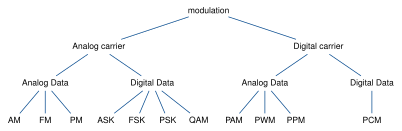{width=640}
:::

In this lecture, we'll look at the three methods on the left, AM, FM and PM. They are the
basis for many of the other methods.

## Amplitude Modulation

This method is already hiding in plain sight on the formula sheet!

$$
u(t)\cos(\omega_0 t) \;\overset{\text{F.T.}}{\rightsquigarrow}\;
\tfrac{1}{2}U\big(j(\omega-\omega_0)\big) + \tfrac{1}{2}U\big(j(\omega+\omega_0)\big).
$$

<!-- CHECK: the source writes both terms as ½U(j(ω−ω₀)). The second term is ½U(j(ω+ω₀)), as in the sketch below it, which has copies at both −ω₀ and ω₀. -->

::: {style="text-align:center"}
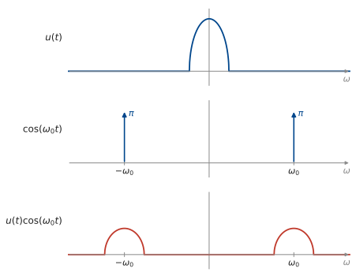{width=560}
:::

This is called <u>Amplitude Modulation (AM)</u>. $\cos(\omega_0 t)$ is called the
carrier.

<!-- CHECK: u(t)cos(ω₀t) is what is usually called DSB-SC (double sideband, suppressed carrier). Conventional AM adds the carrier, (1 + m u(t))cos(ω₀t). Left as written. -->

::: {style="text-align:center"}
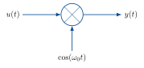{width=300}
:::

::: {style="text-align:center"}
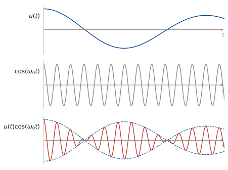{width=560}
:::

The amplitude of the carrier is modulated by the signal.

## Demodulation

How do we recover the signal at the receiver?

If we multiply by the carrier again, we get

$$
\begin{aligned}
z(t) &= y(t)\cos(\omega_0 t) \\[6pt]
     &= u(t)\big(\cos(\omega_0 t)\big)^2 \\[6pt]
     &= \tfrac{1}{2}u(t)\big(1 + \cos(2\omega_0 t)\big)
\end{aligned}
$$

::: {style="text-align:center"}
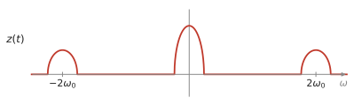{width=560}
:::

We can then lowpass filter to get back $u(t)$.

::: {style="text-align:center"}
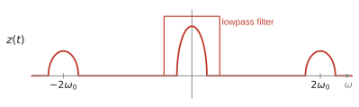{width=560}
:::

## Frequency division multiplexing

What if we want to transmit multiple signals simultaneously? Use separate carrier
frequencies: <u>Frequency Division Multiplexing</u>.

::: {style="text-align:center"}
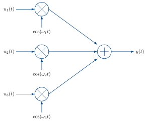{width=420}
:::

<!-- CHECK: the output of the summer is unlabelled in the source. Labelled y(t), the name used for the sum, y = y₁ + y₂ + y₃, on the next page. -->

How do we demodulate this sum? The receiver can choose which signal to demodulate by
multiplying by the corresponding carrier.

::: {style="text-align:center"}
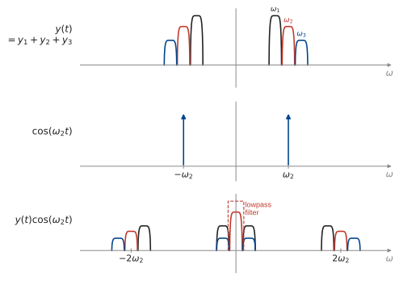{width=640}
:::

If instead we multiply by $\cos(\omega_1 t)$:

::: {style="text-align:center"}
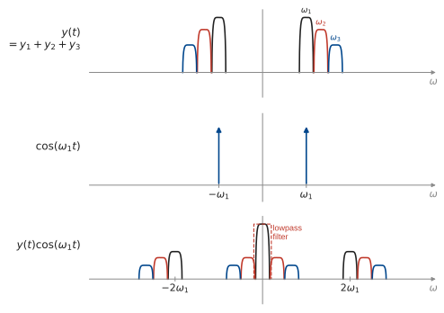{width=640}
:::

This is how the radio station selector on an AM radio works.

<!-- CHECK: the second FDM sketch labels the carrier ω_L (or a bold ω₁), against the text "cos(ω₁t)" above it. Typeset as ω₁. -->

## Frequency modulation

There are two other common ways to embed an analog signal in an analog carrier:
frequency modulation and phase modulation.

$$
\begin{aligned}
&\text{Amplitude modulation:} && y(t) = u(t)\cos(\omega_c t) \\[6pt]
&\text{Frequency modulation:} && y(t) = \cos\!\Big(\omega_c t + k\int_{-\infty}^{t} u(\tau)\,\mathrm{d}\tau\Big) \\[6pt]
&\text{Phase modulation:} && y(t) = \cos\big(\omega_c t + k u(t)\big)
\end{aligned}
$$

<!-- CHECK: the carrier frequency is ω₀ in the AM section and ω_c from here on. Left as written. -->

For a sinusoid with variable frequency, $y(t) = \cos\big(\omega(t)\,t\big)$, we define the
<u>instantaneous frequency</u> to be

$$ \omega_i = \frac{\mathrm{d}}{\mathrm{d}t}\big(\omega(t)\,t\big). $$

<!-- CHECK: the source writes ω_i = d/dt ω(t). For y = cos(ω(t)t) the instantaneous frequency is the derivative of the whole argument, d/dt(ω(t)t), which is what the next two lines use (d/dt ωt = ω, and d/dt of the FM argument). Typeset d/dt(ω(t)t). -->

For a sinusoid with constant frequency, $\cos(\omega t)$, this is just the usual
frequency: $\;\dfrac{\mathrm{d}}{\mathrm{d}t}\,\omega t = \omega$.

For an FM signal, the instantaneous frequency is

$$
\begin{aligned}
&\frac{\mathrm{d}}{\mathrm{d}t}\Big(\omega_c t + k\int_{-\infty}^{t} u(\tau)\,\mathrm{d}\tau\Big) \\[8pt]
&= \omega_c + k\,\frac{\mathrm{d}}{\mathrm{d}t}\int_{-\infty}^{t} u(\tau)\,\mathrm{d}\tau \\[8pt]
&= \omega_c + k u(t).
\end{aligned}
$$

<!-- CHECK: the source's last line is "ω_c + k u(t) − k u(−∞)", with "assume = 0" under the u(−∞) term. The lower limit −∞ is fixed, so d/dt ∫_{−∞}^t u(τ)dτ = u(t) with no extra term. Typeset without it. -->

So the signal $u(t)$ modulates the instantaneous frequency of the carrier.

::: {style="text-align:center"}
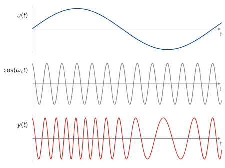{width=560}
:::

What is the bandwidth of FM?

$$ y(t) = \cos\!\Big(\omega_c t + k\int_{-\infty}^{t} u(\tau)\,\mathrm{d}\tau\Big) $$

If we let $k \to 0$, is the spectrum concentrated at $\omega_c$?

$$
y(t) = \cos(\omega_c t)\cos\!\Big(k\int_{-\infty}^{t} u(\tau)\,\mathrm{d}\tau\Big)
     - \sin(\omega_c t)\sin\!\Big(k\int_{-\infty}^{t} u(\tau)\,\mathrm{d}\tau\Big)
$$

As $k \longrightarrow 0$:

$$
\begin{aligned}
\cos\!\Big(k\int_{-\infty}^{t} u(\tau)\,\mathrm{d}\tau\Big) &\longrightarrow 1 \\[8pt]
\sin\!\Big(k\int_{-\infty}^{t} u(\tau)\,\mathrm{d}\tau\Big) &\longrightarrow k\int_{-\infty}^{t} u(\tau)\,\mathrm{d}\tau.
\end{aligned}
$$

So

$$
y(t) \approx \cos(\omega_c t)
\underbrace{- \sin(\omega_c t)\,k\int_{-\infty}^{t} u(\tau)\,\mathrm{d}\tau}_{\substack{\text{same bandwidth as AM} \\ \text{– the bandwidth of } \int u(\tau)\,\mathrm{d}\tau}}.
$$

What is the bandwidth for large $k$?

::: {style="text-align:center"}
{width=600}
:::

::: {.content-visible when-format="html"}
```{=html}
<div id="w-fm" class="widget"></div>
```
:::

::: {.content-visible when-format="pdf"}
{#fig-fm width=100%}
:::

<!-- CHECK: the source says "[insert plot of spectrum for wideband FM]". Inserted the static two-panel figure and the w-fm widget (NEW WIDGET). Both use a single-tone message, so the spectrum is a set of lines with Bessel-function heights. The integral is taken from 0 rather than −∞ for this periodic u. Keep one or both. -->

So FM spreads the signal all over the spectrum. This makes it very robust to noise.

::: {style="text-align:center"}
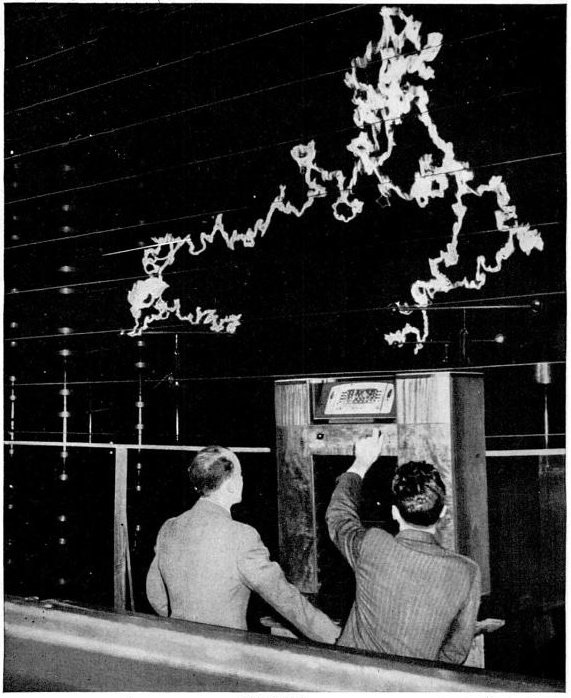{width=440}
:::


## Phase modulation

PM is closely related to FM, but instead of modulating the instantaneous frequency, we
modulate phase.

$$ y(t) = \cos\big(\omega_c t + u(t)\big). $$

This is the same as FM with signal $u'(t)$: calculating the instantaneous frequency of
the PM signal, we have

$$ \frac{\mathrm{d}}{\mathrm{d}t}\big(\omega_c t + u(t)\big) = \omega_c + u'(t). $$

<!-- CHECK: the summary table above gives PM as cos(ω_c t + k u(t)), this section drops the k (k = 1). Left as written. -->

## Example: FM Stereo Multiplexing

How do we transmit both left and right audio channels over FM?

We transmit a composite signal that uses AM to carry both channels:
$\qquad \omega_p = 2\pi\cdot 19\,\text{kHz}.$

$$
u(t) = \underbrace{\big(L(t) + R(t)\big)}_{0\text{–}15\,\text{kHz}}
     + \underbrace{A_p\cos(\omega_p t)}_{19\,\text{kHz}}
     + \underbrace{\big(L(t) - R(t)\big)\cos(2\omega_p t)}_{23\text{–}53\,\text{kHz}}.
$$

How do we recover $L(t)$ &amp; $R(t)$ at the receiver?

There are 4 steps.

**1.** Sum recovery.

::: {style="text-align:center"}
{width=380}
:::

**2.** Carrier recovery.

::: {style="text-align:center"}
{width=460}
:::

$G$ is a narrow bandpass filter at $19\,$kHz.

Squaring the output gives

$$
A_p^2\,|G(j\omega_p)|^2\cos(\omega_p t + \theta)^2
= \tfrac{1}{2}A_p^2\,|G(j\omega_p)|^2\big(1 + \cos(2\omega_p t + 2\theta)\big).
$$

Pass this through a narrow bandpass at $2\omega_p = 2\pi\cdot 38\,\text{kHz}$ to remove the
constant, and normalise amplitude to get $\cos(2\omega_p t + 2\theta)$.

<!-- CHECK: the source writes "2ω_p = 38 kHz". Typeset 2ω_p = 2π·38 kHz to match ω_p = 2π·19 kHz. -->

**3.** Difference recovery.

Multiply $u(t)$ by $\cos(2\omega_p t + 2\theta)$ to get

$$
\begin{aligned}
&(L+R)\cos(2\omega_p t + 2\theta)
+ \colorbox{lightblue}{$A_p\cos(\omega_p t)\cos(2\omega_p t + 2\theta)$} \\[6pt]
&\quad + \colorbox{peachpuff}{$(L-R)\cos(2\omega_p t)\cos(2\omega_p t + 2\theta)$}
\end{aligned}
$$

Simplify the 2^nd^ &amp; 3^rd^ terms using
$\cos a\cos b = \tfrac{1}{2}\big(\cos(a-b) + \cos(a+b)\big)$.

$$
\colorbox{lightblue}{$A_p\cos(\omega_p t)\cos(2\omega_p t + 2\theta)$}
= \tfrac{1}{2}A_p\cos(\omega_p t + 2\theta) + \tfrac{1}{2}A_p\cos(3\omega_p t + 2\theta)
$$

$$
\colorbox{peachpuff}{$(L-R)\cos(2\omega_p t)\cos(2\omega_p t + 2\theta)$}
= \tfrac{1}{2}(L-R)\cos(2\theta) + \tfrac{1}{2}(L-R)\cos(4\omega_p t + 2\theta).
$$

Putting all the terms together, we get

$$
\begin{aligned}
&\underbrace{\tfrac{1}{2}(L-R)\cos(2\theta)}_{0\text{–}15\,\text{kHz}}
+ \underbrace{\tfrac{1}{2}A_p\cos(\omega_p t + 2\theta)}_{19\,\text{kHz}}
+ \underbrace{(L+R)\cos(2\omega_p t + 2\theta)}_{23\text{–}53\,\text{kHz}} \\[10pt]
&+ \underbrace{\tfrac{1}{2}A_p\cos(3\omega_p t + 2\theta)}_{57\,\text{kHz}}
+ \underbrace{\tfrac{1}{2}(L-R)\cos(4\omega_p t + 2\theta)}_{61\text{–}91\,\text{kHz}}.
\end{aligned}
$$

<!-- CHECK: the source writes the 19 kHz term as ½A_p cos(2ω_p t + 2θ). The line above it gives ½A_p cos(ω_p t + 2θ), and only ω_p t sits at 19 kHz. Typeset with ω_p t. -->

Passing this through a lowpass filter with cutoff $15\,$kHz, we get
$\tfrac{1}{2}(L-R)\cos(2\theta)$.

$\theta$ is the filter phase, which is part of the design, so we can divide it off to
recover $L-R.$

**4.** Channel recovery.

Add: $\;L-R + L+R\;$ to get $2L$.

Subtract: $\;L-R - (L+R) = -2R$.

```{=html}
<script src="modulation-widgets.js"></script>
```
