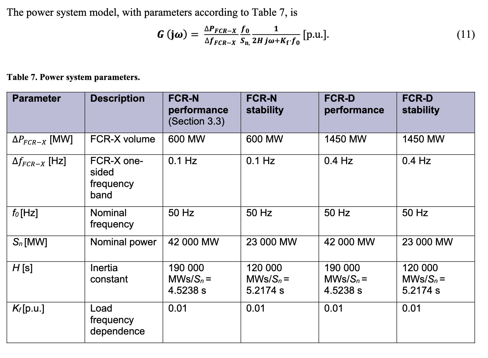
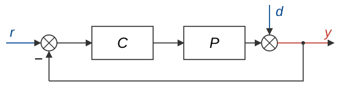
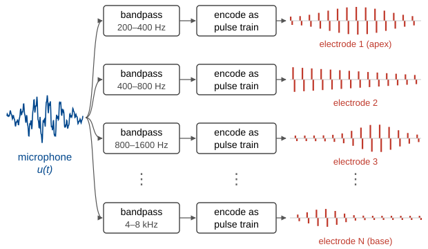
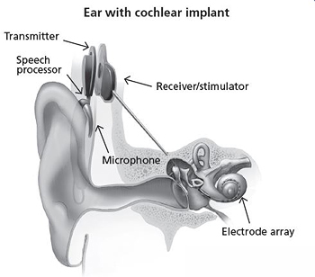
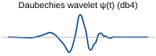
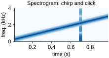
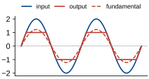
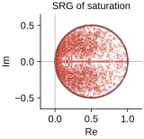

## Feedback control: electricity grid codes

:::: {.columns}
::: {.column width="50%"}
- The frequency of mains power is carefully controlled to 50 Hz.
- Emergency power sources called *frequency containment reserve* are used to correct sudden changes in frequency.
- These emergency power sources must satisfy strict frequency response requirements: an example for the Nordic grid is on the right.
:::

::: {.column width="50%"}
{width=100%}

::: {style="font-size: 0.5em;"}
[Energinet, *FCR technical requirements*, 2022](https://www.energinet.dk/media/gg0grj24/fcr-technical-requirements-2022-06-27_.pdf)
:::
:::
::::

## Feedback control: X-29

X-29: experimental aircraft with unstable pitch stabilised by a control system.

:::: {.columns}
::: {.column width="60%"}
{width=100%}
:::

::: {.column width="40%"}
{width=100%}

::: {style="font-size: 0.5em;"}
Source: NASA
:::
:::
::::

:::: {.columns}
::: {.column width="45%"}
$$
\begin{aligned}
y &= d - PCy \\
y &= \underbrace{\frac{1}{1 + PC}}_{S}\, d
\end{aligned}
$$
:::

::: {.column width="55%"}
Sensitivity to disturbance and measurement error.
:::
::::

## Feedback control: X-29 bandwidth

::: {style="width: 55%; margin: 0 auto;"}
{width=100%}
:::

:::: {.columns}
::: {.column width="55%"}
Bode's sensitivity integral gives a fundamental limitation on what control can achieve.
:::

::: {.column width="45%"}
$$
\int_0^\infty \ln|S(j\omega)|\,d\omega = 6\pi
$$
:::
::::

The other limitation is [bandwidth]{.underline}: the controls can only act as fast as the computer/actuators/comms allow, about 40 rad/s for the X-29.

For the X-29, the combination of these two limitations made it impossible to meet military robustness specs, despite NASA engineers spending several years trying to get it to work.

::: {style="font-size: 0.5em;"}
G. Stein, "Respect the unstable", 1989 Bode Lecture. [Gunter Stein obituary, MIT News, 2026](https://news.mit.edu/2026/gunter-stein-control-systems-theory-expert-dies-1023)
:::

## Audio: noise and echo cancellation

:::: {.columns}
::: {.column width="50%"}
**Noise cancellation**

- Measure incoming noise $n(t)$ with a microphone and play it back inverted.
- The inverted copy arrives with a delay $T$ (a phase lag of $\omega T$).
- The residual noise has amplitude $|1 - e^{-j\omega T}|$: small for low $\omega$, large for high $\omega$.
:::

::: {.column width="50%"}
**Echo cancellation**

- In a video call, the laptop speaker plays the other person's voice $u(t)$, and the microphone records the echo $(u*h)(t)$, where $h(t)$ is the room's impulse response.
- The laptop continuously estimates $h(t)$ and subtracts $(\hat h * u)(t)$ from the microphone signal.
:::
::::

## Spatial convolution and CNNs

- An image is a signal of two variables ($x$ and $y$). Image filters are 2D convolutions: $y[m,n] = \sum_k \sum_l h[k,l]\, u[m-k,\, n-l]$.
- Graphics software uses small kernels $h$ to blur, sharpen and detect edges.
- Convolutional neural networks (CNNs) learn their kernels from data, and stack many layers of convolutions and nonlinearities.

```{=html}
<div id="conv-widget" class="sw"></div>
<script src="widgets/conv-widget.js"></script>
```

## Spatial Fourier transform: MRI

- An MRI scanner uses magnetic field gradients so that protons spin with a frequency proportional to $x$ and a phase proportional to $y$. 
- The received signal is then a sample of the 2D Fourier transform of the image, called k-space.
- The scanner fills in k-space line by line, and an inverse 2D FFT gives the image, as in the demo below.

```{=html}
<div id="mri-widget" class="sw"></div>
<script src="widgets/mri-widget.js"></script>
```

::: {style="font-size: 0.5em;"}
[A. C. Kak and M. Slaney, *Principles of Computerized Tomographic Imaging*, Section 4.4: Magnetic Resonance Imaging](https://engineering.purdue.edu/~malcolm/pct/CTI_Ch04.4.pdf)
:::

## Filter banks and the cochlear implant

:::: {.columns}
::: {.column width="40%"}
- The cochlea is a bank of mechanical filters: each point responds to a different frequency, high at the base and low at the apex.
- A cochlear implant replaces it with an electronic filter bank, with one bandpass filter for each electrode.
- Electrodes directly stimulate the audotiory nerve.
:::

::: {.column width="60%"}
{width=100%}

::: {style="display: flex; gap: 24px; align-items: center; margin-top: -10px;"}
::: {style="flex: 0 0 36%; text-align: center; line-height: 1;"}
{width=100% style="margin: 0;"}<br>
[Source: NIH/NIDCD]{style="font-size: 0.5em;"}
:::

:::
:::
::::

## Beyond LTI systems and sinusoids {.smallest}

:::: {.columns}
::: {.column width="33%"}
### Wavelets

- Instead of sinusoids, use shifted and scaled copies of a short wavelet $\psi(t)$ as basis functions.
- This shows how the frequency content of a signal changes over time, like a spectrogram.

{width=100%}

{width=100%}
:::

::: {.column width="33%"}
### Describing functions

- Drive a nonlinear system with a sinusoid $A \sin \omega t$ and keep only the fundamental of the output.
- This gives an approximate frequency response that depends on the amplitude $A$, which is used to predict oscillations in feedback loops.

{width=100%}
:::

::: {.column width="33%"}
### Scaled Relative Graphs

- Sample the system over all possible pairs of inputs, and plot the gain and the angle between the input difference and the output difference.
- For LTI systems this is closely related to the Nyquist diagram, and for nonlinear systems it gives graphical stability tests.

{width=85%}
:::
::::

## Follow-on courses

- Power systems: ELEC3203 Electricity Networks, ELEC3206 Electrical Energy Conversion Systems
- Digital signal processing: ELEC3305 Digital Signal Processing
- Control: ELEC3304 Control
- Communications: ELEC3505 Communications
- Analog electronics: ELEC3404 Electronic Circuit Design, ELEC3405 Communications Electronics and Photonics
- Medical imaging: BMET3802 Biomedical Instrumentation, ELEC5622 Signals, Software and Health
